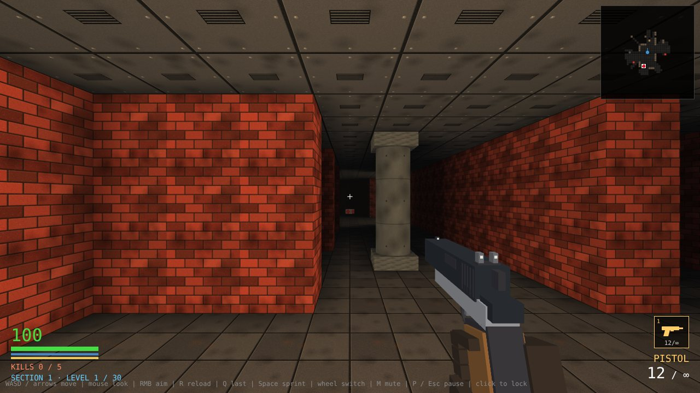
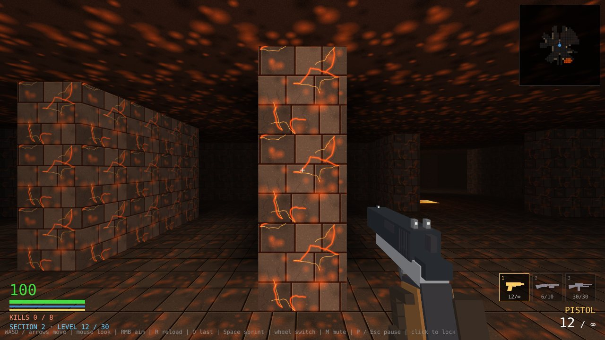
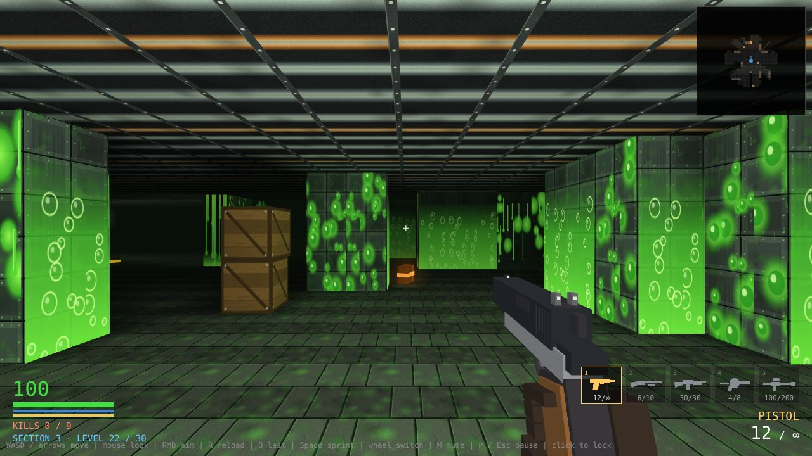
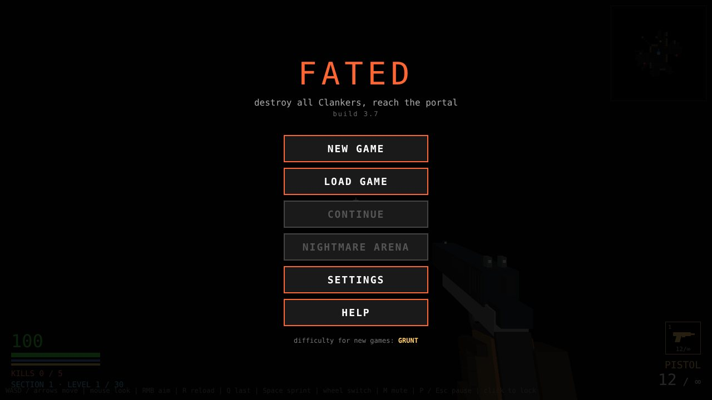

# FATED

**A fast, Doom-inspired first-person shooter in a single HTML file.**
Destroy every Clanker, step into the green portal, and fight through 30 levels and three bosses.

### [Play it in your browser](https://github.mrrat.org/FATED/)

by [MrRat Gaming](https://github.mrrat.org/) &nbsp;·&nbsp; [Discord](https://discord.gg/FybAhsxQHZ)

## The game
Robots called **Clankers** have taken over. Clear each level of them, then reach the exit portal, which only opens once the last Clanker is down. There are **30 levels in 3 sections**, each ending in a boss:

| Section | Levels | Look and feel |
|---|---|---|
| **The Factory** | 1-10 | Brick, concrete and rust. Boss on level 10. |
| **The Foundry** | 11-20 | Furnace light and **lava** that burns through armour. Boss on level 20. |
| **The Sludge** | 21-30 | Dim sewers with glowing **acid** pools, and slimed walls that hurt if you brush them. Boss on level 30. |

## Features
- **Six weapons**, each found on the level that introduces it: pistol, shotgun, rifle, grenade launcher, slime thrower and railgun.
- **Smart enemies.** Grunts, Rushers, Heavies, Snipers, Bombers, Throwers, stealthy ninja Clankers and ceiling-clinging Spiders. They only see you in front of them and in line of sight, and they hear gunfire.
- **Stealth and tactics.** Crouch to stay quiet, use a silencer or bayonet for silent kills, and watch the detection bar. Light and noise give you away.
- **Hidden finds** on each level: silencer, bayonet, chainsaw, frag rounds, flashlight and more.
- **Three difficulties:** Recruit, Grunt and Veteran.
- **Nightmare Arena.** Beat the game on Veteran to unlock endless random levels.
- **Three save slots,** with a checkpoint at the start of every level.
- **Runs offline.** The whole game, including three.js, is in `index.html`.

## Controls
| Action | Key |
|---|---|
| Move | `W` `A` `S` `D` or arrows |
| Look | Mouse (click the game to lock the mouse) |
| Fire / aim down sights | Left click / right click |
| Reload | `R` |
| Choose weapon | `1`-`6` (and `7`), wheel to cycle, `Q` for the last one |
| Sprint | `Space` or `Shift` |
| Crouch | `Z` or `Ctrl` |
| Pistol mod, frag rounds / flashlight, chainsaw | `V`, `F`, hold `C` (once found) |
| Pause / resume | `P` or `Esc` |
| Mute | `M` |

The in-game **Help** page has the complete guide to weapons, enemies, hazards and the HUD.

## Run it yourself
Download `index.html` and open it in a modern desktop browser. To host your own copy, publish the repo with GitHub Pages (Settings, Pages, deploy from `main` / root).

Built with [three.js](https://threejs.org/) r128 (MIT), inlined in the file.

## License
Free for noncommercial use under the [PolyForm Noncommercial License 1.0.0](https://polyformproject.org/licenses/noncommercial/1.0.0). Commercial use needs written permission. See [`LICENSE`](LICENSE).
